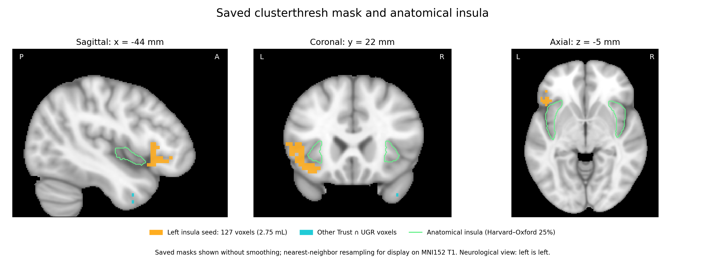

# Saved clusterthresh mask: task intersection and anatomy

**Identity remains unresolved:** this is the tracked `clusterthresh` mask,
not an established identification of Jacob's final manuscript seed. See the
subsequent historical seed inventory and original-group-input audit plan.

The tracked `masks/seed-AIns-clusterthresh.nii.gz` is exactly one connected
component of `masks/ugr-trust_intersection.nii.gz` (26-neighbor connectivity).
The intersection's nonzero support equals the logical AND of the saved
`overlap_figure_ugr_mask.nii.gz` and `overlap_figure_trust_mask.nii.gz`, and equals
the support of `overlap_figure_intersection_mask.nii.gz` in the initial review.
This is a functional task-map intersection, not a cross-task data-coverage mask.

The seed has 127 voxels at approximately 2.7 × 2.7 × 2.97 mm, totaling 2.750 mL.
Its centroid is MNI approximately [-43.53, 21.97, -4.70] mm. The full task
intersection has 365 voxels across seven 26-connected components. The script
`code/get_ugr-trust_intersection.sh` creates the intersection using UGR
offer-unfairness pmod and Trust rec-minus-def `cluster_mask_zstat2` maps. The
masking operation retains UGR cluster labels; its support is the intersection.

The seed lies in the left anterior-insula/ventrolateral frontal region and
extends substantially into adjacent frontal cortex. On the Harvard–Oxford
cortical maximum-probability atlas at the 25% threshold, nearest-neighbor sampled
on the saved seed grid, its voxels are labeled:

| Atlas label | Voxels | Percent of seed |
|---|---:|---:|
| Frontal Orbital Cortex | 69 | 54.3% |
| Inferior Frontal Gyrus, pars triangularis | 22 | 17.3% |
| Frontal Operculum Cortex | 15 | 11.8% |
| Inferior Frontal Gyrus, pars opercularis | 14 | 11.0% |
| Unlabeled | 4 | 3.1% |
| Insular Cortex | 2 | 1.6% |
| Frontal Pole | 1 | 0.8% |

Thus the saved functional cluster is not confined to anatomical insula. This
distinction matters when relating the functional seed to the current anatomical
insula ICA. These labels describe overlap with this atlas/threshold and are not
a registration-quality diagnosis.

Historical wrappers also refer to `seed-AIns.nii.gz` and `seed-AIns-vt.nii.gz`,
which are absent from this checkout. This review verifies the existing
`clusterthresh` file; it does not establish that these differently named seeds
were identical or replace any mask.



Orange is the functional seed, cyan is the rest of the saved task intersection,
and green outlines the Harvard–Oxford anatomical insula. The anatomy is FSL's
MNI152 1-mm brain. Display masks are resampled with nearest-neighbor
interpolation only; measurements use the original seed grid. Slice coordinates
are the rounded seed centroid. Left is left in the coronal and axial panels.
Source identities and numerical checks are saved in `verification.json`.

Reproduce on a computer with FSL's standard image and Harvard–Oxford atlas:

```bash
python code/insula_ica/records/2026-10-30-original-insula-mask-review/plot_mask.py \
  --background "$FSLDIR/data/standard/MNI152_T1_1mm_brain.nii.gz"
```

The figure was visually inspected after generation; no source image or analysis
output was edited.
