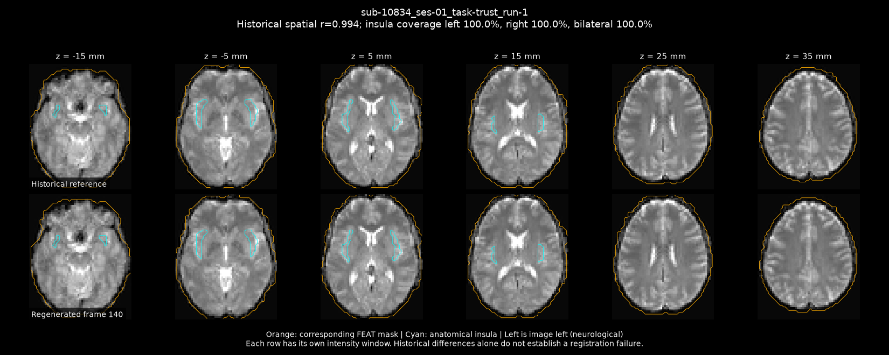
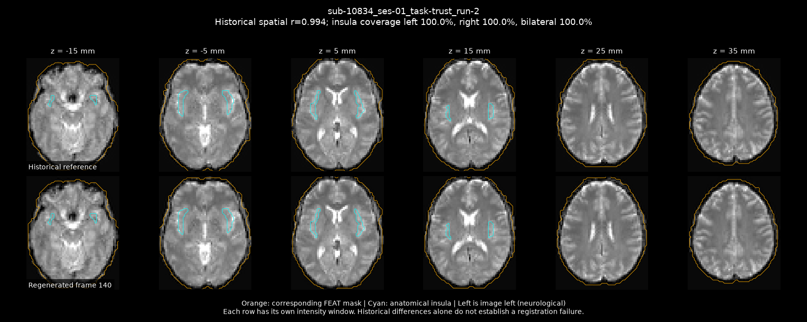

# sub-10834 candidate correction: ignore SBRef

Same fMRIPrep 24.1.1 image and production settings, with `--ignore sbref`. Both Trust runs were refitted with their original joint task+nuisance models. Candidate outputs remain separate; none have replaced the completed cohort.

| Run | Before bilateral coverage | Candidate bilateral coverage | Before frame r | Candidate frame r |
| --- | ---: | ---: | ---: | ---: |
| sub-10834_ses-01_task-trust_run-1 | 59.3% | 100.0% | 0.362 | 0.994 |
| sub-10834_ses-01_task-trust_run-2 | 35.8% | 100.0% | 0.305 | 0.994 |

Full left/right/bilateral values and exact-confound checks: comparison.json. Inspect both QC montages, baseline-registration-reports/ and registration-reports/ before adopting any candidate. Coverage or historical correlation alone does not establish successful registration.

