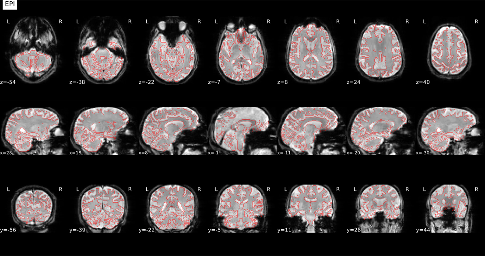
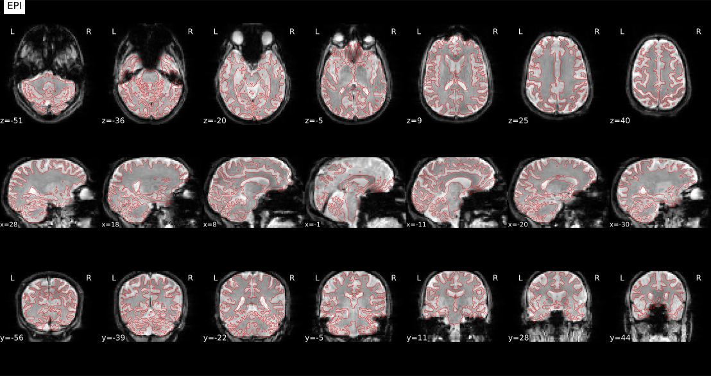
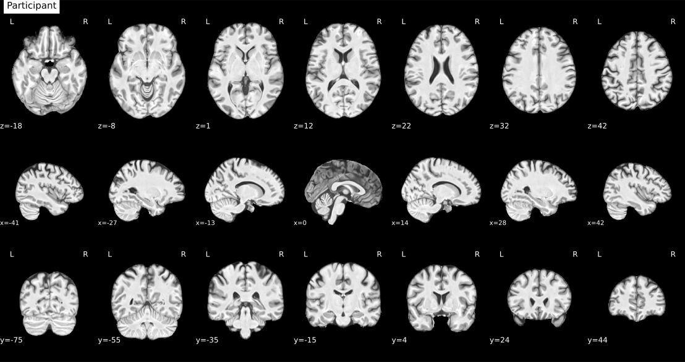

# Review of the sub-10834 correction

Reviewed the GitHub repair record (`387cb14e`) on 2026-10-28. Both repaired inputs are acceptable for this participant's new analysis. This is a case-specific decision, not clearance of the whole regenerated cohort.

## Repair result

| Trust run | Bilateral coverage before | After | Historical frame r before | After |
| --- | ---: | ---: | ---: | ---: |
| run-1 | 59.3% | 100% | 0.362 | 0.994 |
| run-2 | 35.8% | 100% | 0.305 | 0.994 |

Left and right coverage are individually 100% in both repaired runs. Original confound values match exactly, residual validity checks passed, and neither run has the prior automated review flags.

Both BOLD-to-T1w report layers were inspected in three planes; the prior gross displacement is resolved. Native BOLD mask/ROI panels show recovery of superior/anterior support. Both baseline and candidate anatomical normalization panels appear broadly aligned with the MNI template. The historical-versus-regenerated insula montages also look plausibly aligned. These observations support using the repaired pair and retaining sub-10834. They do not establish exact historical reproduction or comprehensive temporal/signal-quality QC.

The repaired outputs remain in their separate root. The paths recommended for future input selection are in review-decision.json. No source images, participant exclusions or linux2 active registry were changed during this review.

## Separate cohort reference-selection problem

The original regeneration audit found 131 same-run references, 108 different-run references (all run 2), and two cases without retained-log evidence (both runs of adopted sub-10478). One of the 108 cross-run findings is sub-10834 run 2, now repaired. Thus 107 other regenerated Trust run-2 inputs still have documented cross-run SBRef selection.

The run-filter error is in the generated rebuild filters and is fixed in the helper for future jobs. A selected run-1 SBRef in run 2 is not a count of demonstrated gross misregistrations. However, full ROI coverage does not validate the reference/transform provenance. Correct or directly validate these cases, resolve the two adopted-case log gaps, and retain original model/confound identity before ICA. No evidence here establishes that the original paper used these faulty rebuild filters.

## Reviewed panels

