# sub-10834 registration diagnostic

Read-only collection from the exact completed preprocessing location. No source images or transforms were changed. No fMRIPrep, FEAT, TEDANA or Warpkit rerun was launched.

Both regenerated Trust runs show gross displacement relative to the atlas insula. These reports are needed to distinguish anatomical normalization, BOLD-to-anatomical registration, brain masking or distortion-correction problems before selecting a correction.

The complete fMRIPrep report remains on linux2: `/ZPOOL/data/projects/rf1-betrayal/derivatives/insula_ica/trust-rebuild-24-linux2-audit-20261026T213907Z-dc0e41/fmriprep-24/sub-10834.html`.

## Registration and masking report assets

### sub-10834_ses-01_task-trust_run-1_part-mag_desc-coreg_bold.svg

### sub-10834_ses-01_task-trust_run-1_part-mag_desc-fmapCoreg_bold.svg

### sub-10834_ses-01_task-trust_run-1_part-mag_desc-sdc_bold.svg

### sub-10834_ses-01_task-trust_run-2_part-mag_desc-coreg_bold.svg

### sub-10834_ses-01_task-trust_run-2_part-mag_desc-fmapCoreg_bold.svg

### sub-10834_ses-01_task-trust_run-2_part-mag_desc-sdc_bold.svg

## Provenance and logs

See diagnostic.json for image geometry, original command/work directory, registration settings and source figure paths. If present, fmriprep-log-excerpt.txt contains matching warning/registration lines and the end of the log.

Copied report assets: 6. Header read errors: 0. No NIfTI files were copied.
