# Trust images for visual QC

Review bundle only. No preprocessing, FEAT, ICA, or exclusions were performed.

The two sub-10834 runs have low insula coverage; inspect these first. Other flags compare against the historical reference and need visual interpretation.

The images compare the retained historical reference with the corresponding regenerated BOLD frame. Orange contours are each row's FEAT mask; cyan contours are the anatomical insula. Intensity windows are independent. No visual pass/fail decisions have been assigned.

## sub-10834_ses-01_task-trust_run-2

left_insula_coverage_below_0.8, right_insula_coverage_below_0.8, bilateral_insula_coverage_below_0.8, historical_reference_spatial_r_below_0.95_review_alignment

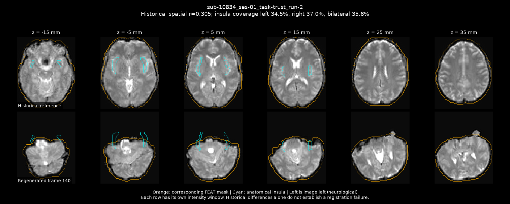

Full fMRIPrep report on linux2: `/ZPOOL/data/projects/rf1-betrayal/derivatives/insula_ica/trust-rebuild-24-linux2-audit-20261026T213907Z-dc0e41/fmriprep-24/sub-10834.html`

## sub-10834_ses-01_task-trust_run-1

left_insula_coverage_below_0.8, right_insula_coverage_below_0.8, bilateral_insula_coverage_below_0.8, historical_reference_spatial_r_below_0.95_review_alignment

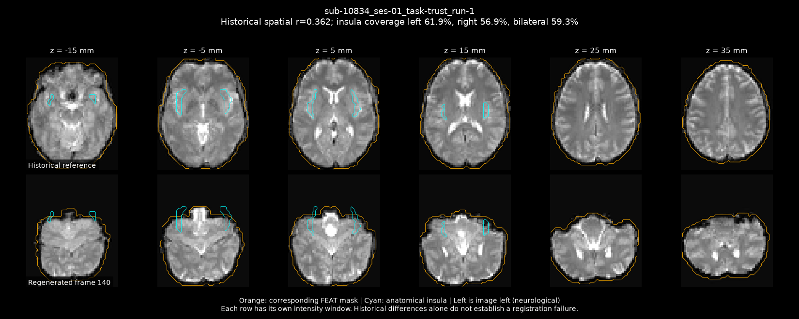

Full fMRIPrep report on linux2: `/ZPOOL/data/projects/rf1-betrayal/derivatives/insula_ica/trust-rebuild-24-linux2-audit-20261026T213907Z-dc0e41/fmriprep-24/sub-10834.html`

## sub-10640_ses-01_task-trust_run-2

historical_reference_spatial_r_below_0.95_review_alignment

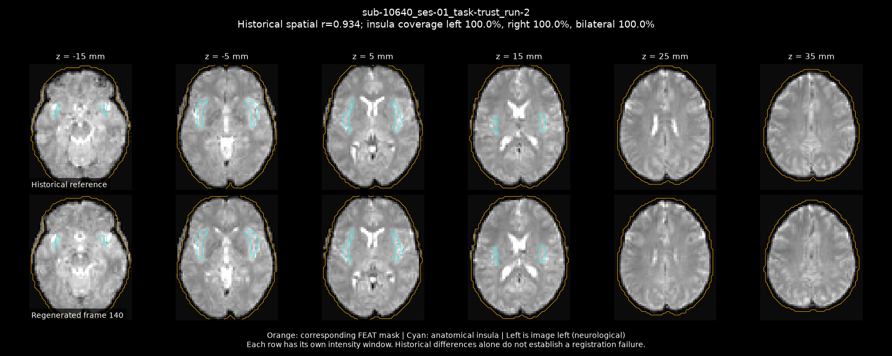

Full fMRIPrep report on linux2: `/ZPOOL/data/projects/rf1-betrayal/derivatives/insula_ica/trust-rebuild-24-linux2-audit-20261026T213907Z-dc0e41/fmriprep-24/sub-10640.html`

## sub-10642_ses-01_task-trust_run-2

historical_reference_spatial_r_below_0.95_review_alignment

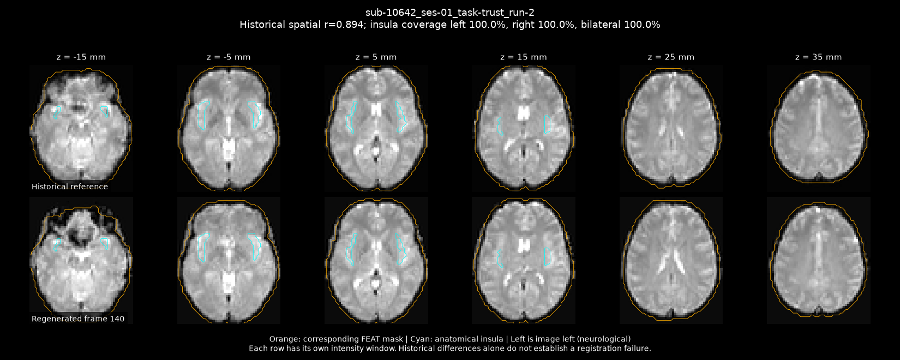

Full fMRIPrep report on linux2: `/ZPOOL/data/projects/rf1-betrayal/derivatives/insula_ica/trust-rebuild-24-linux2-audit-20261026T213907Z-dc0e41/fmriprep-24/sub-10642.html`

## sub-10674_ses-01_task-trust_run-2

historical_reference_spatial_r_below_0.95_review_alignment

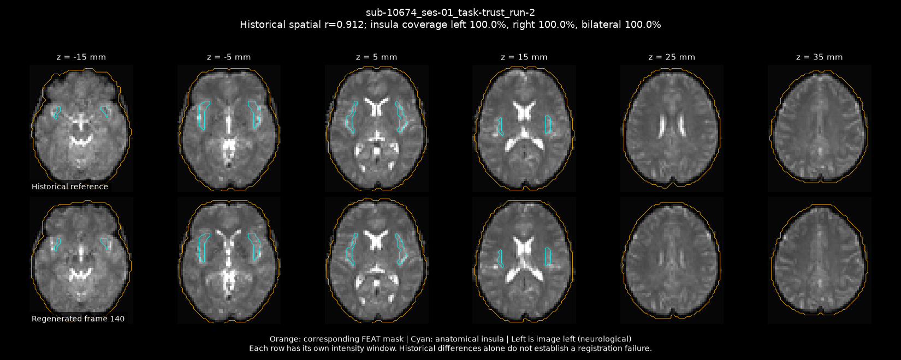

Full fMRIPrep report on linux2: `/ZPOOL/data/projects/rf1-betrayal/derivatives/insula_ica/trust-rebuild-24-linux2-audit-20261026T213907Z-dc0e41/fmriprep-24/sub-10674.html`

## sub-10700_ses-01_task-trust_run-2

historical_reference_spatial_r_below_0.95_review_alignment

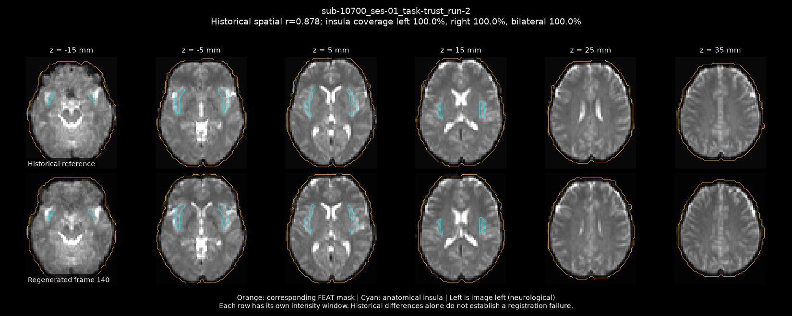

Full fMRIPrep report on linux2: `/ZPOOL/data/projects/rf1-betrayal/derivatives/insula_ica/trust-rebuild-24-linux2-audit-20261026T213907Z-dc0e41/fmriprep-24/sub-10700.html`

## sub-10767_ses-01_task-trust_run-2

historical_reference_spatial_r_below_0.95_review_alignment

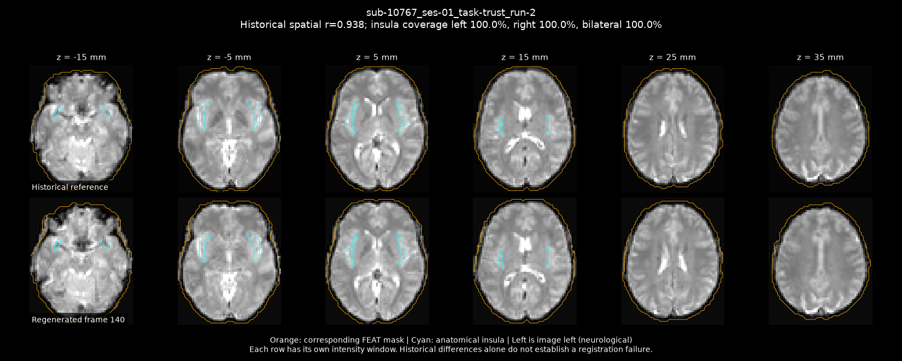

Full fMRIPrep report on linux2: `/ZPOOL/data/projects/rf1-betrayal/derivatives/insula_ica/trust-rebuild-24-linux2-audit-20261026T213907Z-dc0e41/fmriprep-24/sub-10767.html`

## sub-10800_ses-01_task-trust_run-2

historical_reference_spatial_r_below_0.95_review_alignment

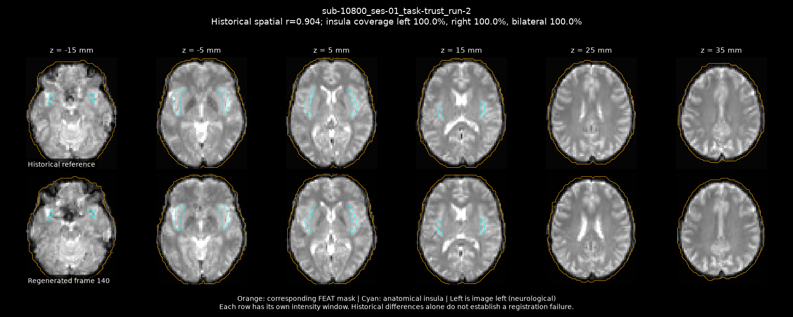

Full fMRIPrep report on linux2: `/ZPOOL/data/projects/rf1-betrayal/derivatives/insula_ica/trust-rebuild-24-linux2-audit-20261026T213907Z-dc0e41/fmriprep-24/sub-10800.html`

## sub-10801_ses-01_task-trust_run-2

historical_reference_spatial_r_below_0.95_review_alignment

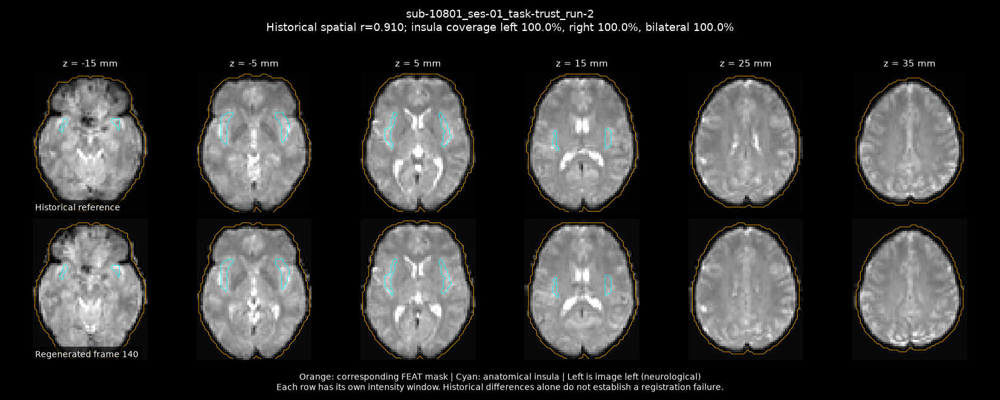

Full fMRIPrep report on linux2: `/ZPOOL/data/projects/rf1-betrayal/derivatives/insula_ica/trust-rebuild-24-linux2-audit-20261026T213907Z-dc0e41/fmriprep-24/sub-10801.html`

## sub-10860_ses-01_task-trust_run-2

historical_reference_spatial_r_below_0.95_review_alignment

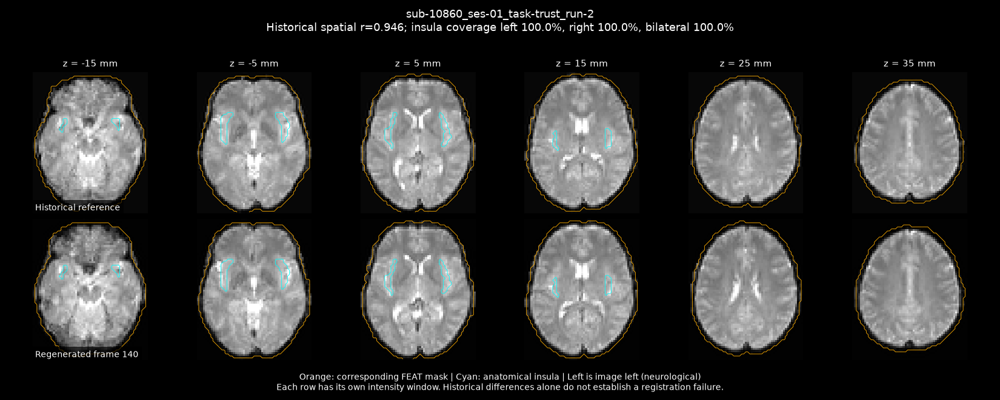

Full fMRIPrep report on linux2: `/ZPOOL/data/projects/rf1-betrayal/derivatives/insula_ica/trust-rebuild-24-linux2-audit-20261026T213907Z-dc0e41/fmriprep-24/sub-10860.html`

## sub-10875_ses-01_task-trust_run-2

historical_reference_spatial_r_below_0.95_review_alignment

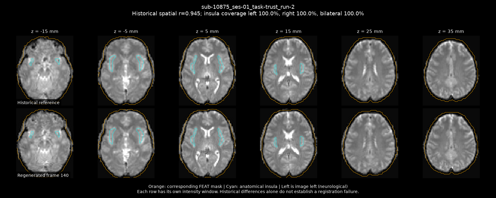

Full fMRIPrep report on linux2: `/ZPOOL/data/projects/rf1-betrayal/derivatives/insula_ica/trust-rebuild-24-linux2-audit-20261026T213907Z-dc0e41/fmriprep-24/sub-10875.html`

## sub-10918_ses-01_task-trust_run-2

historical_reference_spatial_r_below_0.95_review_alignment

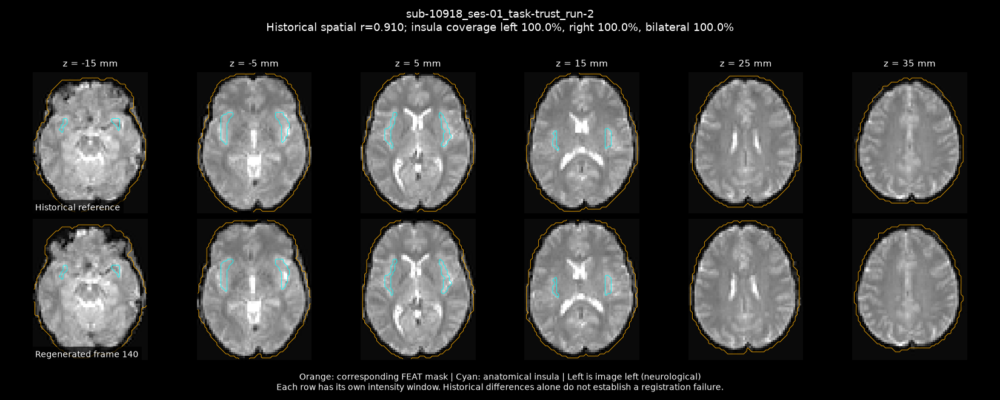

Full fMRIPrep report on linux2: `/ZPOOL/data/projects/rf1-betrayal/derivatives/insula_ica/trust-rebuild-24-linux2-audit-20261026T213907Z-dc0e41/fmriprep-24/sub-10918.html`

## sub-10924_ses-01_task-trust_run-2

historical_reference_spatial_r_below_0.95_review_alignment

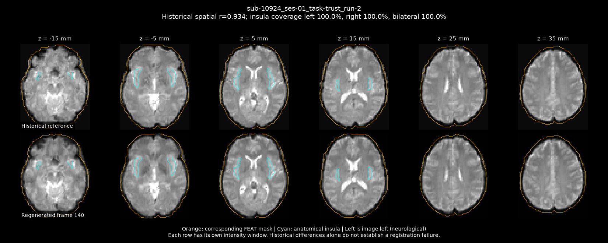

Full fMRIPrep report on linux2: `/ZPOOL/data/projects/rf1-betrayal/derivatives/insula_ica/trust-rebuild-24-linux2-audit-20261026T213907Z-dc0e41/fmriprep-24/sub-10924.html`

## sub-10966_ses-01_task-trust_run-2

historical_reference_spatial_r_below_0.95_review_alignment

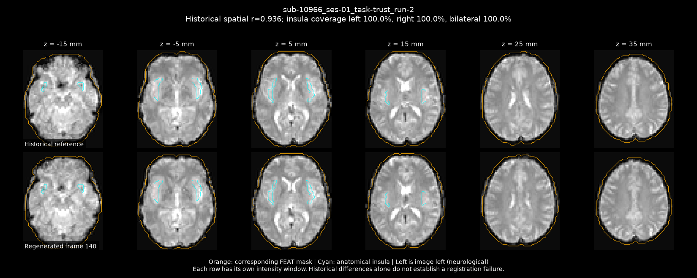

Full fMRIPrep report on linux2: `/ZPOOL/data/projects/rf1-betrayal/derivatives/insula_ica/trust-rebuild-24-linux2-audit-20261026T213907Z-dc0e41/fmriprep-24/sub-10966.html`

## sub-10969_ses-01_task-trust_run-2

historical_reference_spatial_r_below_0.95_review_alignment

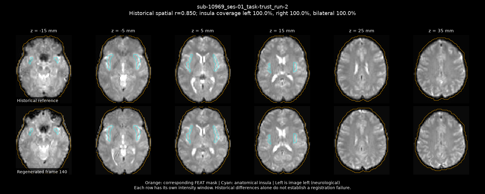

Full fMRIPrep report on linux2: `/ZPOOL/data/projects/rf1-betrayal/derivatives/insula_ica/trust-rebuild-24-linux2-audit-20261026T213907Z-dc0e41/fmriprep-24/sub-10969.html`

## sub-11060_ses-01_task-trust_run-2

historical_reference_spatial_r_below_0.95_review_alignment

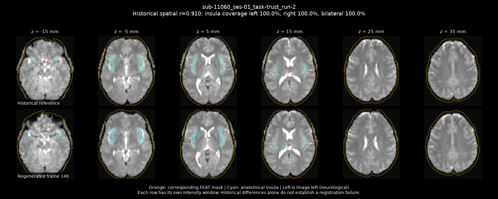

Full fMRIPrep report on linux2: `/ZPOOL/data/projects/rf1-betrayal/derivatives/insula_ica/trust-rebuild-24-linux2-audit-20261026T213907Z-dc0e41/fmriprep-24/sub-11060.html`

## sub-11068_ses-01_task-trust_run-2

historical_reference_spatial_r_below_0.95_review_alignment

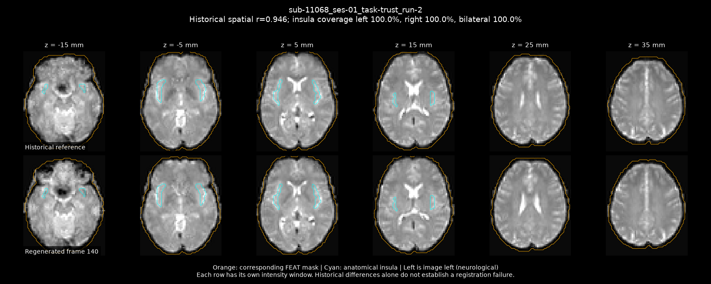

Full fMRIPrep report on linux2: `/ZPOOL/data/projects/rf1-betrayal/derivatives/insula_ica/trust-rebuild-24-linux2-audit-20261026T213907Z-dc0e41/fmriprep-24/sub-11068.html`

## sub-11325_ses-01_task-trust_run-2

historical_reference_spatial_r_below_0.95_review_alignment

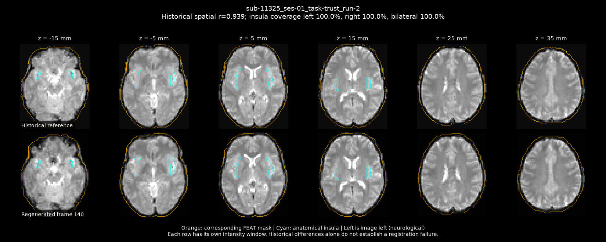

Full fMRIPrep report on linux2: `/ZPOOL/data/projects/rf1-betrayal/derivatives/insula_ica/trust-rebuild-24-linux2-audit-20261026T213907Z-dc0e41/fmriprep-24/sub-11325.html`

## sub-11337_ses-01_task-trust_run-2

historical_reference_spatial_r_below_0.95_review_alignment

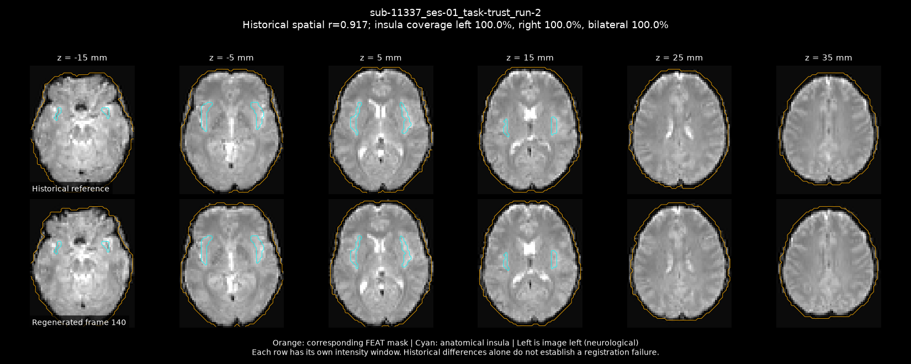

Full fMRIPrep report on linux2: `/ZPOOL/data/projects/rf1-betrayal/derivatives/insula_ica/trust-rebuild-24-linux2-audit-20261026T213907Z-dc0e41/fmriprep-24/sub-11337.html`

## sub-11530_ses-01_task-trust_run-2

historical_reference_spatial_r_below_0.95_review_alignment

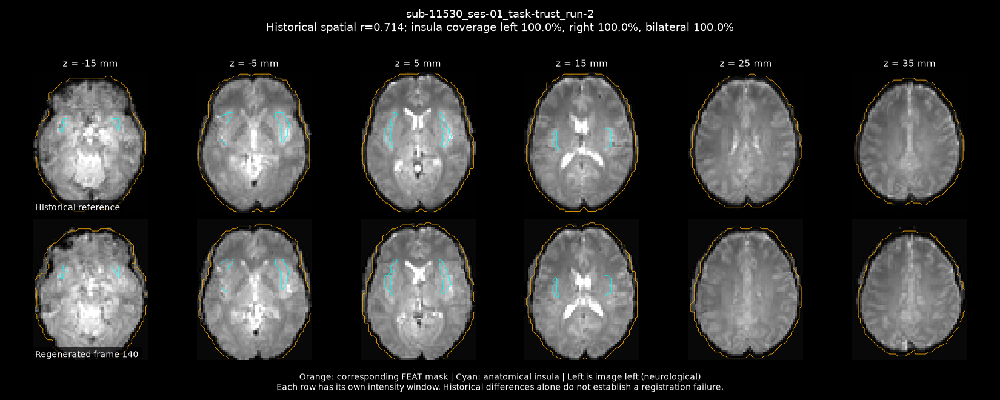

Full fMRIPrep report on linux2: `/ZPOOL/data/projects/rf1-betrayal/derivatives/insula_ica/trust-rebuild-24-linux2-audit-20261026T213907Z-dc0e41/fmriprep-24/sub-11530.html`
