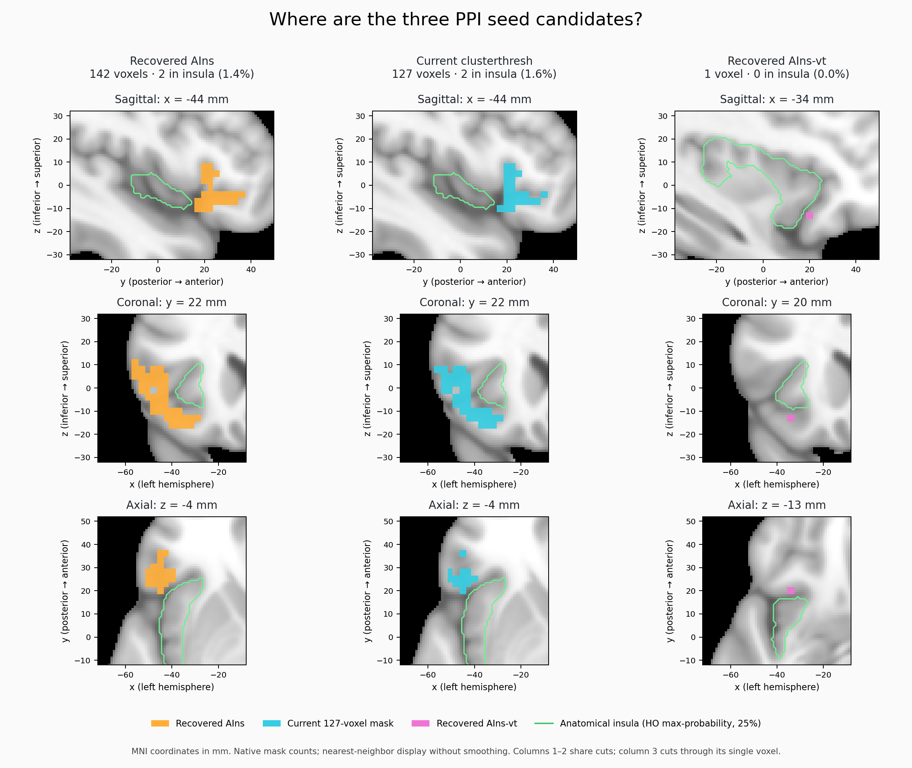

# Spatial comparison of PPI seed candidates — 2026-10-30



All three masks are in the left hemisphere. Anatomical overlap uses the Harvard–Oxford cortical maximum-probability atlas, threshold 25%, sampled with nearest-neighbor interpolation at original seed voxel centers. The reported percentage is the fraction of seed voxels assigned to Insular Cortex, not the fraction of the entire insula covered. This atlas assignment is an operational anatomical definition, not a subject-specific histological boundary.

| Mask | Voxels | Insular Cortex | Frontal Orbital Cortex | IFG triangularis | IFG opercularis | Frontal operculum |
|---|---:|---:|---:|---:|---:|---:|
| Recovered AIns | 142 | 2 (1.4%) | 73 (51.4%) | 27 (19.0%) | 17 (12.0%) | 16 (11.3%) |
| Current clusterthresh | 127 | 2 (1.6%) | 69 (54.3%) | 22 (17.3%) | 14 (11.0%) | 15 (11.8%) |
| Recovered AIns-vt | 1 | 0 (0%) | 1 (100%) | 0 | 0 | 0 |

The remaining voxels in the first two rows are unlabeled (6 and 4 respectively) or Frontal Pole (1 each). Both large masks are predominantly left frontal orbital and inferior frontal/opercular cortex. Their centroids are MNI (-44.3, 22.3, -4.3) and (-43.5, 22.0, -4.7) mm. They share 123 voxels (Dice 0.9145): recovered AIns has 19 unique voxels, current clusterthresh has 4. Thus the current mask is not an exact subset of the recovered mask.

The recovered AIns-vt is a single voxel at MNI (-34.3, 19.8, -12.6) mm, assigned to Frontal Orbital Cortex, anterior/ventral to the atlas insula. This voxel is contained in both larger masks.

The first two display columns use identical sagittal/coronal/axial cuts; the third uses cuts through its single voxel. All columns share spatial fields of view. The green outline shows anatomical insula. Seed resampling is nearest-neighbor for display only, without smoothing. Counts are measured on original seed grids. Current production mask bytes were checked against the recovered 127-voxel copy and are identical. Full source hashes, voxel sizes, bounds, label counts and pairwise overlaps are in `anatomy.json`.

This comparison describes three surviving/recovered candidate files. It does not establish which historical binary mask generated the original PPI timecourses; that provenance limitation remains as documented in the PPI audit review. Original mask files and production analyses were not modified.

Reproduce with Python containing nibabel, scipy, numpy and matplotlib:

```bash
OPENBLAS_NUM_THREADS=1 MPLCONFIGDIR=/tmp/rf1-seed-mpl python \
  code/ppi_seed_audit/records/2026-10-30-seed-anatomy/plot_seeds.py --fsldir "$FSLDIR"
```
