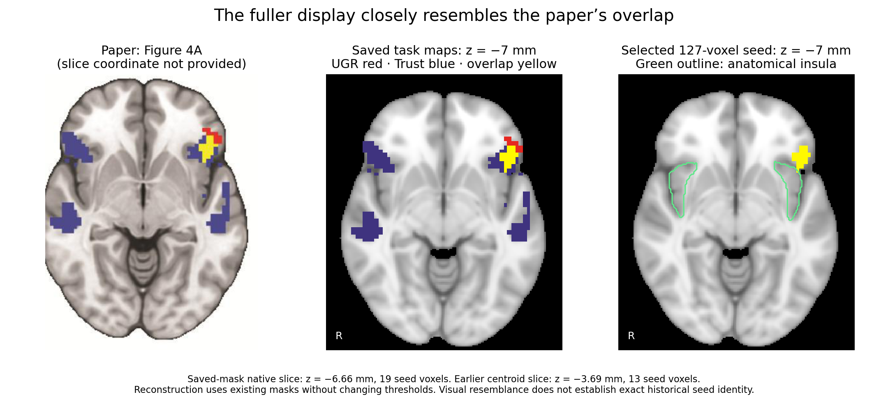

# Paper-versus-saved overlap display — 2026-11-01

The prior seed-anatomy figure showed only the selected masks at a centroid axial cut near z = −4 mm. Figure 4A in the June 12, 2026 preprint shows the full task maps (UGR red, Trust blue, intersection yellow), without a slice-coordinate annotation or anatomical insula outline.

The existing saved overlap_figure masks shown near z = −7 mm closely resemble the published spatial pattern, including the yellow left frontal patch and the surrounding bilateral Trust activation. This comparison changes only display slice and layer context, not any statistical threshold. It supports a display explanation for much of the apparent size difference. It is not a voxelwise validation of the raster figure, nor proof that the current binary mask was the historical PPI seed.

The original 127-voxel seed contains 19 voxels in native axial slice z = −6.66 mm and 13 in the previously shown centroid slice z = −3.69 mm, a 46% difference in visible slice area. Its full 3D count remains 127. The full saved whole-brain intersection has 365 voxels across seven connected clusters; the selected 127-voxel cluster is just one. At all nine displayed low axial slices, every intersection voxel belongs to that selected cluster, so the larger global count does not explain additional local overlap in the paper's low axial view.

Anatomical assignment remains 2/127 Insular Cortex voxels (1.6%) using the Harvard–Oxford cortical maximum-probability 25% atlas at native seed voxel centers. The right comparison panel adds that atlas boundary in green to the same slice. Display size and task overlap should be distinguished from anatomical-insula overlap.

The full adjacent-slice montage is in `saved_overlap_axial_slices.png`. Native slice counts and original mask hashes are in `measurements.json`. Original publication image attribution, DOI, version, license and PDF/image hashes are in `paper-source.json`; `Figure4_original.jpg` is the original embedded figure extracted from PDF page 8, retained under its CC-BY 4.0 license. No participant images or fitted models were modified. The background is FSL's standard MNI152 T1 1-mm template. All mask resampling is nearest-neighbor for display, with no smoothing.

Run `plot_overlap.py` with Python/nibabel/scipy/numpy/matplotlib and `FSLDIR` set to reproduce the comparison. The exact historical seed-file identity remains unresolved as in the preceding audit.
