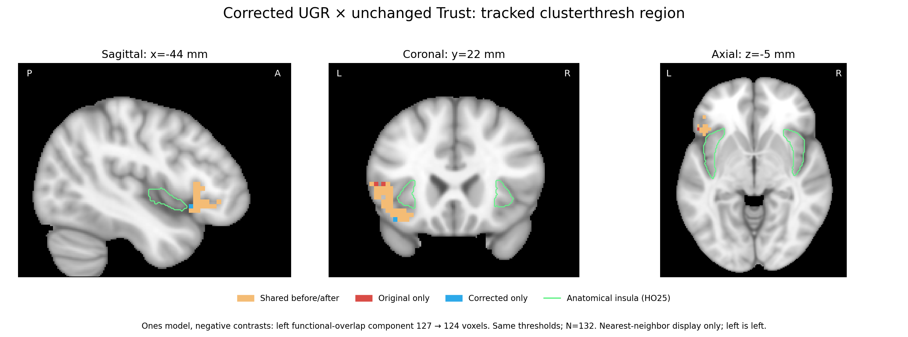

# Corrected versus original UGR activation results

Reviewed the completed six-group repair published as 4ccc2622. All six cases
finished, with no recorded errors. N remains 132. The saved group models,
covariates, contrast definitions and thresholds were verified by the runner.
The two affected participant inputs were changed as specified in plan.json;
all other participant estimates were reused. Trust maps are unchanged.

## Broad spatial patterns

Original/corrected whole-brain Z-map correlations on the common group mask:

| Contrast | Ones model | Full-covariate model / covs-vt |
|---|---:|---:|
| Fairness, COPE11 | 0.99635 | 0.99377 |
| Social minus nonsocial, COPE12 | 0.99426 | 0.99099 |

The full and covs-vt variants have the same Z maps and differ in thresholding.
Group-mask Dice overlap is 0.999830, so the comparison is not driven by a
substantial change in spatial support. High map correlation does not establish
identical effects or unchanged thresholded inference.

For fairness, thresholded whole-brain voxel counts change as follows, with
the original settings retained for each model:

| Model | Positive contrast, original → corrected | Negative contrast, original → corrected |
|---|---:|---:|
| ones | 2840 → 3008 | 545 → 500 |
| full | 1928 → 2123 | 485 → 457 |
| covs-vt | 11 → 12 | 7 → 10 |

Thus the broad fairness pattern is similar, but negative and positive tails do
not change uniformly. No monotonic improvement in group effects is assumed
from repairing an input.

## Social-minus-nonsocial thresholded result changes

The full-covariate model's original negative COPE12 result contained one
21-voxel cluster; no corrected cluster survives the same correction. The
positive direction remains empty. Both directions remain empty in ones and
covs-vt models, as in the original outputs.

The lost original cluster's centroid is approximately MNI [-2.0, -51.3, -2.0]
mm. Within that fixed original region, peak Z changes from 4.4705 to 4.2377 and
mean Z from 3.4605 to 3.3132. Sixteen of the original 21 voxels remain above
Z=3.1. This is loss of corrected threshold survival, not disappearance of the
entire unthresholded signal or a demonstrated sign reversal. The paper's
description of this particular result should be checked against corrected
inference; these numbers alone do not establish which manuscript claim used it.

## Anatomical-insula task overlap does not increase

Recomputed the negative fairness × negative Trust rec-minus-def intersections
using the **unchanged matching Trust model**, the same original thresholds and
the same Harvard–Oxford maximum-probability 25% insular label, nearest-neighbor
sampled on the original group grid:

| Group model | Whole task intersection, original → corrected | Anatomical-insula voxels, original → corrected |
|---|---:|---:|
| ones | 365 → 348 | 2 → 2 |
| full | 328 → 318 | 2 → 2 |
| covs-vt | 7 → 9 | 0 → 0 |

The two insular voxels are the same voxels before and after in both
cluster-thresholded models. They are not merely equal counts at different
locations. The positive task intersections increase from 560 to 609 (ones)
and 401 to 455 (full), but have zero anatomical-insula voxels before and after.

Using an objective 26-connected-component correspondence to the original
127-voxel clusterthresh mask, the ones-model left functional-overlap component
changes from **127 to 124 voxels**: 121 shared, six lost and three gained.
The analogous full-model component changes from 116 to 111 voxels. The voxelwise
variant has a one-voxel component touching that old region, unchanged in size.
Repair does not resolve the available functional cluster's mostly
frontal/opercular anatomical placement.



The figure shows shared voxels in pale orange, original-only voxels in red,
corrected-only voxels in blue and anatomical insula in green. Measurements use
the original grid; nearest-neighbor resampling is for display only. It depicts
the matching functional component, not the entire task intersection.

This review does not promote a new seed, change any thresholds, identify the
historical PPI extraction mask or report corrected PPI results. Those remain
separate work.

## Records and reproduction

`verification.json` records source identities, all twelve group/sign comparisons,
six task intersections, shared insula voxels and the lost-cluster measurements.
The TSVs provide the same group and overlap summaries. Whole-brain correlation
and mask-Dice values come from the runner's original/common-mask comparisons;
thresholded image counts and overlaps were independently recomputed from the
published 3D images and checked against those comparisons. The figure was
visually inspected.

Reproduce with FSL's standard anatomical image and atlas:

```bash
python code/ugr_reanalysis/review_activation.py \
  --atlas "$FSLDIR/data/atlases/HarvardOxford/HarvardOxford-cort-maxprob-thr25-1mm.nii.gz" \
  --background "$FSLDIR/data/standard/MNI152_T1_1mm_brain.nii.gz"
```
